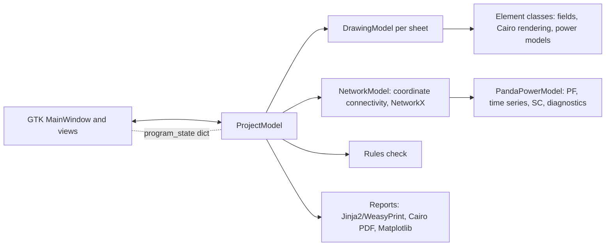
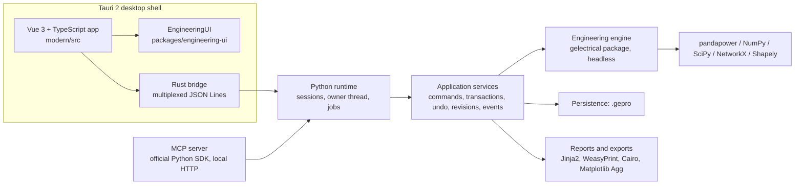

# GElectrical architecture overview

This page is the top-level map. It separates the **current implementation**
(GTK3 desktop application) from the **proposed architecture** (Tauri + Vue
frontend over a headless Python backend). Detailed contracts live in
[docs/architecture/](docs/architecture/); the migration plan lives in
[docs/migration/](docs/migration/README.md). Start at the
[documentation index](docs/README.md).

Status: Phase 1 (planning) complete and reviewed by the owner on 2026-11-26
([decisions](docs/migration/risks-and-decisions.md#2-owner-decisions)). Implemented
so far: regression baseline (M1, M1b), headless engine (M2: `gelectrical/` imports
without GTK, legacy UI in `gelectrical/gtk/`) and the frontend foundation (M6).

## Current implementation (GTK3)



Before M2 the engine and GUI were interleaved (every module imported GTK
through `gelectrical/__init__.py` and `misc.py`, element geometry came from
Cairo rendering, `ProjectModel` owned GTK views; see the
[existing application audit](docs/migration/existing-application-audit.md)).
Since M2 (*current*): the engine (`core`, `elementmodel`, `symbols`, `model`,
`analysis`, `persistence`, `reports`) imports no GTK; `ProjectModel` notifies
subscribers instead of owning views; the GTK UI (`gelectrical/gtk/`) subclasses
it as `GtkProjectModel`, opens the dialogs and keeps PangoCairo text rendering.
`program_state` survives only inside the GTK UI.

## Proposed architecture



| Layer | Location (proposed) | Owns | Must not |
| --- | --- | --- | --- |
| Engineering engine | `gelectrical/` (headless) | Element definitions, field semantics, calculations, connectivity, pandapower models, protection curves, rules | Import GTK, Tauri, Vue, MCP or transport code |
| Persistence | `gelectrical/persistence/` | `.gepro` read/write, migrations, atomic save | Depend on services or UI |
| Reports/exports | `gelectrical/reports/` | HTML/PDF report, drawing PDF, JSON, spreadsheets | Depend on GTK |
| Application services | `modern/backend/services/` | Sessions, validated commands, transactions, undo/redo, revisions, change events, analysis jobs | Duplicate engine logic |
| Desktop transport | `modern/backend/` + `modern/src-tauri/` | JSON Lines protocol, process lifecycle | Make domain decisions |
| MCP adapter | `modern/backend/mcp/` | Tool schemas, permissions, resources/skills | Write project state except through services |
| Frontend | `modern/src/` | Presentation, interaction, temporary edit state, visual feedback | Calculate or validate engineering values |
| EngineeringUI (MIT) | `packages/engineering-ui/` (`@kavilgroup/engineering-ui`) | Reusable themed components, charts, data grid, drawing viewport | Import GElectrical/GEstimator code or backend method names |

Key rules:

1. **Python is authoritative** for project state, validation and calculations.
2. **One writer:** desktop and MCP call the same services on one owner thread
   per process; there is no second writable project copy.
3. **Every mutation is a command** that validates, applies, records one undo
   entry, increments the revision and emits a change event.
4. **Engine is headless:** importable and testable without GTK, a display,
   Tauri or a frontend (headless Cairo is allowed).
5. **Compatibility:** existing `.gepro` files, element codes, field semantics
   and engineering results are preserved; deviations need an ADR and evidence.

## Proposed repository structure

```text
GElectrical/
├── AGENTS.md, ARCHITECTURE.md
├── gelectrical/                 # headless engine (Python package; name kept)
│   ├── core/                    # fields, units, ids, safe expressions, constants
│   ├── elementmodel/            # element classes (domain only) + registry
│   ├── symbols/                 # declarative symbol definitions and geometry
│   ├── model/                   # project, drawing, network, pandapower, protection, rules
│   ├── persistence/             # .gepro format and migrations
│   ├── reports/                 # report, drawing PDF, spreadsheet exports
│   ├── database/, templates/
│   └── gtk/                     # legacy GTK UI until retirement (moved from __init__/view/interface)
├── modern/
│   ├── backend/                 # runtime, services, JSON Lines, mcp/
│   ├── src/                     # Vue application (views, composables, services, types)
│   ├── src-tauri/               # Rust shell and sidecar lifecycle
│   └── e2e/                     # Playwright tests against the real backend
├── packages/engineering-ui/     # reusable UI library (npm workspace)
├── tests/                       # pytest: engine, services, MCP, regression baseline
├── tools/                       # smoke test, baseline capture, checks
├── sample_files/
├── docs/                        # user manual (Sphinx) + developer docs
├── package.json, package-lock.json   # npm workspaces root
└── pixi.toml, pixi.lock         # Python environment
```

The structure is introduced milestone by milestone; see the
[implementation plan](docs/migration/implementation-plan.md).

## Where to read next

| Topic | Document |
| --- | --- |
| Backend layers, protocol, commands, undo, jobs | [backend](docs/architecture/backend.md) |
| Vue application structure | [frontend](docs/architecture/frontend.md) |
| Reusable UI library | [EngineeringUI](docs/architecture/engineering-ui.md) |
| `.gepro` format and compatibility | [project format](docs/architecture/project-format.md) |
| Schematic editor evaluation | [schematic editor](docs/architecture/schematic-editor.md) |
| Charts and curve editors | [graphing](docs/architecture/graphing.md) |
| Future design modules | [design services](docs/architecture/design-services.md) |
| MCP server | [MCP](docs/architecture/mcp.md) |
| Packaging and distribution | [packaging](docs/architecture/packaging.md) |
| Decisions | [ADRs](docs/decisions/README.md) |
