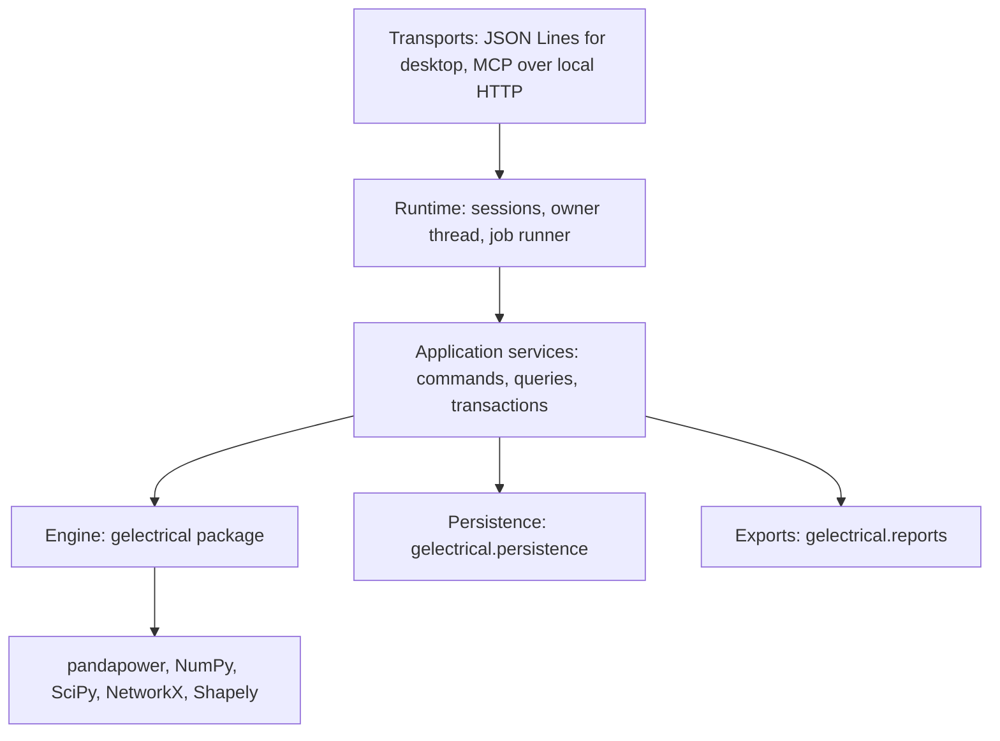

# Backend architecture

Status: **proposed** (Phase 1). The current implementation is described in the
[audit](../migration/existing-application-audit.md). Navigation:
[index](../README.md) · [architecture overview](../../ARCHITECTURE.md) ·
[project format](project-format.md) · [MCP](mcp.md) · [frontend](frontend.md).

The backend is a headless Python process. It owns engineering project state,
validation, calculations, persistence, undo/redo and exports. The desktop
frontend and the MCP server are adapters over the same application services.

## 1. Layers

Dependencies point downwards only. The engine never imports services,
transports, `modern`, GTK or MCP. Services never import a transport.

## 2. Engine package (`gelectrical/`)

The package name `gelectrical` is kept so that existing imports, packaging and
project semantics stay stable. The refactor splits responsibilities without
changing engineering behaviour ([ADR 0014](../decisions/0014-legacy-gtk-location.md)).

| Proposed module | Content | Source today |
| --- | --- | --- |
| `gelectrical/__init__.py` | Version only; no GTK import | Today holds `MainApp`/`MainWindow` |
| `gelectrical/core/constants.py` | Element-code groups, units, paper sizes, analysis modes, file version | `misc.py` constants |
| `gelectrical/core/fields.py` | Field dict construction, truncation/update helpers, `FieldDict`, selection-list helper | `misc.get_field_dict`, `get_fields_*`, `update_fields*`, `set_field_selection_list`, `get_fields_from_params` |
| `gelectrical/core/expressions.py` | Bounded safe evaluator for numeric entry, curve definitions and rules | Replaces `eval()` ([ADR 0011](../decisions/0011-safe-expressions.md)) |
| `gelectrical/core/ids.py` | Stable element and sheet identifiers | New ([ADR 0008](../decisions/0008-project-format-compatibility.md)) |
| `gelectrical/core/paths.py` | `abs_path`, library resolution (`open_library`) with traversal checks | `misc.py` |
| `gelectrical/elementmodel/registry.py` | Single `code → class` registry, palette groups, advanced flags | Today built in `MainWindow.__init__` |
| `gelectrical/elementmodel/*.py` | Fields, ports, `get_nodes`, `get_power_model`, `set_text_field_value`, `calculate_parameters`, curves | Same files, minus Cairo/Pango drawing |
| `gelectrical/symbols/` | Declarative symbol definitions, label formatting, extents, Cairo renderer for PDF | `schem_model`, `text_model`, `render_*`, `misc.draw_*` |
| `gelectrical/model/project.py` | Project document: sheets, fields, load profiles; no views | `model/project.py` minus GTK |
| `gelectrical/model/drawing.py` | Sheet document: elements, page fields, template, title block; geometry queries without `cairo.Region` | `model/drawing.py` |
| `gelectrical/model/networkmodel.py`, `pandapower.py`, `protection.py`, `rulescheck.py`, `graph.py` | Unchanged semantics; take explicit inputs instead of `program_state` | Same files |
| `gelectrical/analysis/` | Pipeline orchestration (diagnostics → PF → SC → results → rules) returning typed results | `ProjectModel.run_*`, `MainWindow.on_run_analysis` |
| `gelectrical/persistence/` | `.gepro` load/save, version detection, migrations, atomic write | `MainWindow.open_project/on_save`, `get_model/set_model` |
| `gelectrical/reports/` | Report HTML/PDF (one PDF adapter: WeasyPrint Python API, or the WeasyPrint executable on Windows, [ADR 0016](../decisions/0016-weasyprint-windows-executable.md)), drawing PDF, spreadsheet export, report graphs with Matplotlib `Agg` | `ProjectModel.export_*`, `view/graph.GraphImage`, `misc.Spreadsheet` |
| `gelectrical/gtk/` | Legacy GTK UI (`MainApp`, views, Glade files) until retirement | `__init__.py`, `view/`, `interface/`, GTK parts of `misc.py` |

Rules for the engine refactor:

- Keep element classes as the single source of field definitions, field-change
  side effects and calculations. Do not re-express them in schemas, TypeScript
  or MCP descriptions; generate those views from the classes.
- Replace `program_state` with explicit arguments (project settings, load
  profiles, registry). A temporary adapter may keep the legacy GTK app working.
- Remove GTK and Pango imports from engine modules. Cairo may remain for PDF
  output and headless text measurement.
- Make geometry independent of rendering: `get_dimensions()` must not depend on
  a prior `render_element()` call. Extents come from symbol geometry plus text
  metrics computed by `gelectrical.symbols.metrics`.
- Element calculations must be deterministic and free of I/O except reading
  bundled or user libraries through `core.paths`.

### Headless text metrics

Element extents depend on text size. Decision rule (owner, 2026-11-26),
applied with [milestone M2](../migration/implementation-plan.md) measurements:

1. Preferred: Cairo toy text API or fontTools metrics with the bundled
   schematic font (no `gi` in the sidecar); must match current extents within
   one grid unit.
2. Fallback: PangoCairo via PyGObject without GTK (closest to current output,
   adds `gi` and Pango to the sidecar), only if option 1 cannot match.

Extents affect hit areas, assembly boxes and PDF layout, **not connectivity**.
The frontend measures its own SVG text for interaction; Python extents are used
for PDF export and headless queries.

*Current (M2, [ADR 0018](../decisions/0018-headless-engine-split.md)):*
option 1 is used. `gelectrical.symbols.text.CairoTextBackend` (Cairo toy API,
point sizes at 96 dpi like Pango, lines aligned like a Pango layout) is the
engine default; the legacy GTK app installs the PangoCairo backend. Measured
on all 249 elements of the baseline projects, Cairo extents differ from
PangoCairo extents by at most 3 drawing units (one grid unit is 16;
`tests/test_symbols_extents.py`). Glyph rendering differs (kerning, synthetic
bold), so headless drawings differ from the legacy raster by 0.12–0.61 % of
pixels at 150 dpi (all 25 drawings above the 0.1 % limit); with PangoCairo text they are pixel-identical. Headless
captures with Cairo text are checked against a separate 1 % raster limit
(owner decision 2026-11-27, ADR 0018). `osifont` is resolved through
the system font configuration (fontconfig on Linux) for both backends.

## 3. Domain identity

- Each element and sheet receives a stable `uid` (UUID4 string) when created or
  loaded. Commands, events, MCP tools and the frontend address elements by
  `uid`, never by list index.
- The file format keeps positional references for compatibility (assembly
  `children_codes`), and adds `uid` as an additive key. See
  [project format](project-format.md).
- Global node numbers are analysis artefacts. Services expose nodes as stable
  sets of `(element uid, port index)` so results can be re-attached after edits.

## 4. Runtime and sessions (`modern/backend/runtime.py`)

Adapted from GEstimator's `Runtime`:

- One process hosts one `Runtime` with an **owner thread** and a bounded request
  queue. All reads and writes of project state run on the owner thread.
- Each open document is a `Session` (project document, undo history, revision,
  analysis results, dirty flag, file path). Sessions are independent; there is
  no shared mutable default state (fixes D4).
- The MCP adapter targets the **active session** chosen by the desktop, plus
  explicit session selection where a tool allows it.
- HTTP/MCP threads only parse and authenticate; they submit work to the owner
  queue and wait for results with bounded timeouts.

## 5. Application services (`modern/backend/services/`)

Services expose **queries** (read-only) and **commands** (mutations).

| Service | Queries | Commands |
| --- | --- | --- |
| `ProjectService` | state, settings, sheets, recent files | new, open, save, save_as, close, set_settings |
| `CatalogService` | element types, field schemas, palette groups, symbols | — |
| `DrawingService` | sheet contents, element details, selection helpers, connectivity | insert, move, rotate, delete, set_fields, add_wire, edit_wire, assemble, ungroup, paste, link_references, renumber, sheet add/remove/reorder/update |
| `LibraryService` | database catalogues, search, item details | apply_database_item |
| `LoadProfileService` | profiles, library profiles | set_profiles (one undo entry) |
| `ProtectionService` | evaluated curves for elements, coordination dataset | set_protection_parameters |
| `AnalysisService` | job status, results, messages, overlays | start_analysis, cancel, clear_results, run_rules_check |
| `ExportService` | — (exports do not change project state) | export_report, export_drawing_pdf, export_json, export_protection_settings |
| `HistoryService` | undo/redo availability and labels | undo, redo |

### Command contract

Every command:

1. Validates inputs (types, ranges, selection lists, existence of `uid`s,
   `if_revision` when supplied) **before** any change.
2. Runs inside a `Transaction`. Nested commands join the outer transaction.
3. Applies changes through engine methods (for fields: `set_text_field_value`,
   so derived fields update exactly as today).
4. On success: records **one** undo entry with a human-readable label,
   increments the session `revision`, marks the session dirty and emits a
   `changed` event with the affected `uid`s and categories.
5. On failure: restores the pre-transaction state completely and returns a
   structured error. No partial writes.
6. Supports `preview=True`: executes, collects the result and change set, then
   rolls back without touching history, revision or dirty state.

### Transactions and undo ([ADR 0009](../decisions/0009-undo-transactions.md))

Proposed: snapshot-based transactions over the canonical document.

- Before the first change, the transaction captures the serialized state of the
  parts it touches (per-element `get_model()` plus `uid`, sheet fields, project
  fields, load profiles). Undo restores the captured "before" state; redo
  restores the "after" state.
- Undo granularity and labels must match the current application for each
  user action (verified by the undo tests in the
  [regression baseline](../migration/regression-baseline.md)).
- The vendored `undo.py` remains for the legacy GTK app until retirement.
- History is bounded (configurable, default 200 entries). Opening or creating a
  project clears history, as today.

### Revisions and change events

- `revision` is a per-session integer incremented by every committed command,
  undo and redo.
- Events: `{"event": "changed", "session": "...", "revision": 42,
  "changes": [{"kind": "element", "uids": [...]}, {"kind": "sheet", ...}],
  "source": "desktop" | "mcp"}`.
- The frontend refreshes affected data after an event. Desktop edits carry the
  revision they were based on; a stale edit is rejected and the typed value is
  kept for retry (pattern from GEstimator).

## 6. Analysis jobs

Analysis can take seconds to minutes (time series, large networks). It must not
block the owner thread or the UI.

1. `start_analysis(settings)` validates settings, captures an immutable
   **snapshot** of the project document at the current revision and returns a
   `job_id` immediately.
2. A job runner executes the existing pipeline on the snapshot:
   network model → power models → diagnostics → PF/time series → SC →
   result mapping → optional rules check → optional exports.
3. Progress events: `{"event": "progress", "job": "...", "stage": "sc_sym",
   "fraction": 0.4, "message": "..."}`.
4. Cancellation is cooperative between stages. If PoC measurements show long
   single stages, run jobs in a **worker process** (spawned once and kept warm)
   for hard cancellation and isolation from the owner thread
   ([ADR 0003](../decisions/0003-backend-transport.md) open question).
5. Results are stored per session with the source revision. If the project
   changed since, results are flagged **stale** in the UI and MCP responses.
6. Analysis does **not** insert display-node elements into the document
   (fixes D7; approved by the owner 2026-11-26, feature E09 `Changed`). Node
   markers become a results overlay keyed by node identity.

Result records are typed (`value`, `unit`, `caption`, `decimal`, optional
time-series), derived from current `res_fields` so that captions and units stay
identical.

## 7. Desktop JSON Lines protocol

Adapted from GEstimator ([ADR 0003](../decisions/0003-backend-transport.md)),
with multiplexing and unsolicited events.

- UTF-8 JSON objects, one per line, on stdin/stdout. Diagnostics go to stderr.
- Request: `{"id": "r-17", "session": "s-1", "method": "drawing.move",
  "params": {...}}`.
- Response: `{"id": "r-17", "result": {...}}` or
  `{"id": "r-17", "error": {"code": "STALE_REVISION", "message": "...",
  "field": "...", "details": {...}}}`.
- Events (no `id`): `changed`, `progress`, `job_finished`, `session_closed`,
  `mcp_status`, `log`.
- Requests may be outstanding concurrently; responses can arrive out of order.
  The Rust bridge matches responses by `id` and forwards events as Tauri events
  (GEstimator's bridge blocks on one request at a time; GElectrical must not).
- Error codes: `INVALID_REQUEST`, `VALIDATION_ERROR`, `NOT_FOUND`,
  `STALE_REVISION`, `CONFLICT`, `FILE_ERROR`, `JOB_ERROR`, `CANCELLED`,
  `BACKEND_ERROR`.
- Limits: line length, ID length and array sizes are bounded (initial values
  from GEstimator: 2,000,000 characters per line, 100 characters per ID).
- `shutdown` closes sessions and exits; the Rust side kills and reaps the child
  if it does not exit.

Method names are namespaced by service (`project.open`, `drawing.insert`,
`analysis.start`, ...). The canonical list will be generated from the service
registry and documented here when M4 lands.

## 8. Data contracts (summary)

| Contract | Shape (indicative) |
| --- | --- |
| Element type | `{code, name, group, advanced, icon, tooltip, ports, fields: FieldSchema[], symbol}` |
| FieldSchema | `{code, type, caption, unit, decimal, selection_list, selection_images, enabled, editable, floating, tooltip, alter_structure}` derived from field dicts |
| Element | `{uid, code, sheet_uid, x, y, orientation, ports, fields: {code: value}, field_state: {code: {enabled, selection_list}}, label_lines}` |
| Wire | `{uid, points: [[x, y], ...]}` |
| Result field | `{code, caption, unit, value, decimal, graph?}` |
| Message | `{severity, title, text, uids: [...], nodes: [...]}` |

Numbers cross the boundary as JSON numbers for engineering floats (values are
already floats in the engine). User-typed arithmetic is sent as strings and
evaluated by `core.expressions`.

## 9. Security and robustness

- No `eval`, `exec` or `pickle` on project, database, clipboard or MCP data
  ([ADR 0011](../decisions/0011-safe-expressions.md)). *Current since M3*
  (`core/expressions.py`, `core/database.py`, `model/clipboard.py`; report
  autoescape and URL fetcher in `reports/export.py`).
- Validate file paths; resolve library files only inside allowed roots.
- Save atomically (temporary file in the same directory, fsync, replace) and
  keep the previous file as a backup. See [project format](project-format.md).
- Reports: enable Jinja2 autoescaping and restrict WeasyPrint URL fetching to
  bundled resources.
- Long-running work never holds the owner thread.

## 10. Testing hooks

- Engine and services are importable under pytest without a display.
- `tests/` uses the real engine and sample projects; transports are tested by
  spawning `python -m modern.backend` (JSON Lines) and through the MCP SDK
  client. See the [testing guide](../testing.md).
