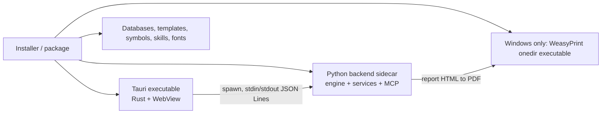

# Packaging and distribution

Status: **proposed architecture; decisions accepted 2026-11-26** (PyInstaller
onedir, Python 3.14, WeasyPrint executable on Windows); M5 records measurements.
Navigation: [index](../README.md) · [backend](backend.md) ·
[ADR 0010](../decisions/0010-python-environment-and-sidecar.md) ·
[ADR 0015](../decisions/0015-python-and-pandapower-versions.md) ·
[ADR 0016](../decisions/0016-weasyprint-windows-executable.md).

## 1. Current distribution

| Channel | Mechanism | Files |
| --- | --- | --- |
| Windows | PyInstaller bundle + NSIS installer | `pyinstaller_spec.spec`, `installer.nsi` |
| Flatpak | GNOME 46 runtime; builds GEOS and Python deps | `com.kavilgroup.gelectrical.json`, `build_flatpak.sh` |
| Snap | core22 | `snapcraft.yaml`, `snap/` |
| Python package | `setup.py`, `MANIFEST.in` | legacy |
| Development | pixi (conda-forge; pandapower and WeasyPrint from PyPI), Python 3.14 | `pixi.toml`, `pixi.lock` |

`requirements.txt` and `setup.py` pin pandapower 3.5.6 and WeasyPrint 70.0 like
`pixi.lock` (M1b, defect D11). The Flatpak manifest still builds pandapower
2.14.9 and WeasyPrint 62.3 on GNOME 46 (Python 3.11), and Snap (core22,
Python 3.10) cannot install the new pins; both need updating before their next
release.

## 2. Target shape

- Tauri 2 produces NSIS (Windows), `.deb` and AppImage (Linux) and `.dmg`/`.app`
  (macOS). The WebView is the operating system's (WebView2 on Windows,
  WebKitGTK on Linux, WKWebView on macOS).
- The Python backend ships as a self-contained sidecar. Users never install
  Python.
- Data files (databases, report templates, symbols, skills, schematic font) ship
  inside the sidecar or as Tauri resources; the manifest lists every new data
  directory (successor of the current `pyinstaller_spec.spec`/`MANIFEST.in` rule).

## 3. Sidecar options

| Option | Description | Pros | Cons |
| --- | --- | --- | --- |
| A. PyInstaller `--onefile` (GEstimator) | Single executable registered as Tauri `externalBin` | Simple Tauri integration; proven in GEstimator | Extracts the full scientific stack to a temp folder on **every start** (hundreds of MB) — slow cold start |
| B. PyInstaller `--onedir` | Folder shipped as Tauri resources; Rust spawns `<resources>/backend/gelectrical-backend` | No extraction; fast start; PyInstaller hooks exist for NumPy/SciPy/pandas/Numba/Shapely | Must collect WeasyPrint's Pango/HarfBuzz/fontconfig libraries and pandapower data files; per-platform hook maintenance |
| C. Packed conda environment | Relocatable environment from the pixi lock (pixi-pack or conda-pack, to evaluate) shipped as resources; Rust runs `python -m modern.backend` | Same binaries as development; native libraries included; no freezing surprises | Largest size; relocation and signing checks; must strip unused packages |

Decision (ADR 0010, accepted): **B**, PyInstaller onedir built from the pixi
environment on Python 3.14 (PyInstaller from conda-forge). **C** is the
fallback if B needs extensive hooks. A is measured only as a comparison point.
M5 records installer size, unpacked size, cold start, warm start and robustness
on clean machines.

## 4. Native and runtime dependencies

| Dependency | Concern | Plan |
| --- | --- | --- |
| Python 3.14 | Newest version supported by both Numba and pandapower (ADR 0015) | conda-forge interpreter from the pixi lock |
| NumPy, SciPy, pandas, NetworkX, Shapely (GEOS) | Size; DLL collection | Standard hooks; verify Shapely GEOS DLLs on Windows |
| Numba + llvmlite | JIT compile on first power flow; cache directory | Set `NUMBA_CACHE_DIR` to the user cache directory; warm up in background after start; measure first-analysis latency |
| pandapower | Latest release (3.5.x) is on PyPI only; data files, optional dependencies | Locked through pixi `[pypi-dependencies]`; include package data; verify `pp.diagnostic`, SC, time series in packaged build |
| WeasyPrint | cffi loads Pango, HarfBuzz, fontconfig, GLib at runtime | **Windows:** official `weasyprint-windows-onedir` executable as a Tauri resource, not bundled in the sidecar (ADR 0016). **Linux/macOS/Flatpak:** Python package with conda-forge or runtime libraries and a fontconfig configuration for bundled fonts. Same pinned version on all platforms |
| Pycairo / cairo | Drawing PDF | Bundle cairo, freetype, fontconfig |
| PangoCairo (`gi`) | Only if chosen for headless text metrics | Avoid if the M2 metrics decision allows; otherwise bundle `gi` typelibs |
| Matplotlib | Report graphs (Agg) | Exclude GUI backends and Tk |
| MCP SDK | `mcp`, `uvicorn`, `starlette`, `pydantic` (compiled core), `anyio`, `httpx` | Available on conda-forge; measure size |
| Fonts | Schematic font (osifont), report fonts | Bundle `osifont.ttf` (GPL-3.0 with font exception: redistribution and PDF embedding allowed) with its licence text |

Exclude GTK, PyGObject GUI typelibs, Tk and test packages from the sidecar.

## 5. Process lifecycle

- Rust starts the sidecar lazily on first request (GEstimator pattern) or at
  startup to warm imports; the choice is measured in M5.
- The sidecar exits when stdin closes (parent gone), on `shutdown`, or when the
  Rust side kills it. On Windows the child is assigned to a job object so it
  dies with the parent; on Linux `PR_SET_PDEATHSIG` (or a stdin watchdog) does
  the same.
- Transport failure marks the backend disconnected; the UI offers reconnect and
  recovery of autosaved work.
- Development mode runs `pixi run python -m modern.backend` instead of the
  frozen sidecar (GEstimator uses `.venv`; GElectrical uses the pixi
  environment).

## 6. Startup performance targets (to confirm in M5)

| Measure | Target |
| --- | --- |
| Window visible | < 1 s |
| Backend ready for open/save | < 3 s cold, < 1.5 s warm |
| First analysis on `sample.gepro` | < 10 s cold (including Numba JIT), < 3 s warm |
| Installer size | Recorded; compare with the current 128 MB Flatpak bundle |

Heavy imports (pandapower, Matplotlib, WeasyPrint) load lazily on first use.

## 7. Channels

| Channel | Plan | Notes |
| --- | --- | --- |
| Windows | Tauri NSIS, per-user or per-machine (`installMode: both`) | Code signing optional (certificate cost); WebView2 bootstrapper |
| Linux `.deb`/AppImage | Built on Ubuntu 22.04 for glibc compatibility (GEstimator) | `.gepro` MIME type and desktop file |
| Flatpak (Flathub) | Build Tauri and the backend from source offline on the GNOME runtime (GEstimator `packaging/flathub/` pattern); Python dependencies from source/wheels | WebKitGTK from the runtime; dialog portal feature |
| Snap | Repackage the release `.deb` (GEstimator) | core22 or later |
| macOS | Unsigned CI builds first (conda-forge osx-64/osx-arm64, Tauri `.dmg`) | Decided 2026-11-26. Signing and notarization (paid Apple developer account) decided later; unsigned builds show Gatekeeper prompts. WeasyPrint uses the Python package |

Keep pixi as the reproducible development and build environment
([ADR 0010](../decisions/0010-python-environment-and-sidecar.md)). Node.js and Rust
come from their standard toolchains; npm `package-lock.json` and Cargo
`Cargo.lock` are committed.

## 8. CI/CD (GitHub Actions)

- **Quality** (pull requests): pixi install, pytest (engine, services, MCP,
  regression), legacy smoke test under `xvfb-run` while GTK exists, npm ci,
  type-check, Vitest, Storybook test run, Playwright against the real backend.
- **Release** (tags/manual): per-OS matrix builds the sidecar on the target OS
  (no cross-compilation), then Tauri bundles; uploads artefacts; Snap and
  Flatpak jobs follow GEstimator's release workflow.
- Packaged-app checks run on clean VMs/runners: start, open sample, run
  analysis, export report and drawing, close without orphan processes.

## 9. Proof of concept scope (M5)

1. Minimal backend entry (`python -m modern.backend`) that opens a sample
   project headlessly, runs the full analysis and exports report and drawing.
2. Freeze with option B (and C if needed) on Linux and Windows from the pixi
   environment; on Windows, generate the report through the WeasyPrint onedir
   executable and compare it with the Linux report.
3. Minimal Tauri shell that spawns the sidecar, sends requests, shows progress
   and kills the child on exit.
4. Measure section 6 targets, sizes and orphan-process behaviour; record in the
   validation log and ADR 0010.
