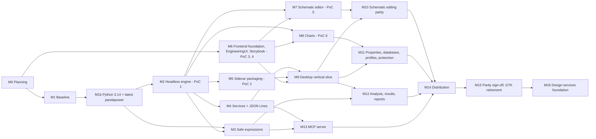

# Implementation plan

Status: **approved plan** (owner review 2026-11-26; decisions in
[risks and decisions](risks-and-decisions.md#2-owner-decisions)). Navigation: [migration index](README.md)
· [feature inventory](feature-inventory.md) · [regression baseline](regression-baseline.md)
· [risks and decisions](risks-and-decisions.md) · [roadmap](../roadmap.md).

The plan is dependency ordered. Each milestone is a set of focused branches and
pull requests, each leaving the repository working. Progress is measured by
**feature-inventory rows marked Done with evidence** and **baseline checks
passing**, never by the number of files moved.

## Dependency overview

Parallel tracks after M1/M2: **engine** (M3, M4, M13), **packaging** (M5),
**frontend** (M6, M7, M8). M6 can start immediately after Phase 1 approval
because it needs no backend.

---

## M0 — Planning and architecture (this phase)

- **Objective:** audit, target architecture, decisions and plan.
- **Deliverables:** documents listed in the [migration index](README.md).
- **Acceptance:** owner review; open decisions answered or explicitly deferred.

## M1 — Regression baseline and test scaffold

- **Objective:** capture the current engineering behaviour as a numeric oracle
  **before** any refactor.
- **Scope:** pytest scaffold; baseline capture harness running the *legacy*
  code; additional coverage projects; CI workflow.
- **Dependencies:** M0.
- **Relevant modules:** `tools/smoke_test.py`, `model/*`, `elementmodel/*`,
  `sample_files/`.
- **Approach:**
  1. Add `pytest` (and `pytest-xvfb` or `xvfb-run` in CI) to `pixi.toml`
     (feature `test`).
  2. Write `tools/baseline/capture.py` that, like the smoke test, constructs the
     legacy `MainWindow` (unshown), opens each project and records the canonical
     JSON described in [regression baseline](regression-baseline.md): canonical
     model, topology, pandapower input tables, PF/time-series/SC results,
     element `res_fields`, rules-check messages, evaluated protection and damage
     curves, renumbering output, undo/redo sequences and save/load round trips.
  3. Build coverage projects under `tests/projects/` so every registered element
     code and every analysis mode is exercised (scripted through the legacy
     model API under a display, then reviewed in the GTK app).
  4. Commit baseline JSON under `tests/baseline/` with the environment manifest
     (pixi lock hash, pandapower/NumPy/SciPy versions, platform).
  5. `tests/test_baseline.py` compares fresh captures with stored ones using the
     tolerance table.
  6. GitHub Actions workflow `quality.yml`: pixi install, smoke test and
     baseline comparison under `xvfb-run` on Linux; Windows job for smoke test.
- **Deliverables:** harness, coverage projects, committed baseline, CI.
- **Acceptance criteria:** baseline capture is deterministic (two runs
  identical within tolerance on the same machine); all sample and coverage
  projects pass; CI green; every registered element code appears in at least
  one project; documented gaps listed in regression-baseline.md.
- **Required tests:** `test_baseline.py`, smoke test.
- **Risks:** nondeterminism (dict ordering, set iteration, pandapower solver
  tolerance, time stamps in outputs) — normalize and sort; display requirement
  — xvfb.
- **Compatibility:** read-only with respect to engine code; no behaviour change.

## M1b — Python and pandapower upgrade

- **Objective:** move to Python 3.14 and the latest pandapower
  ([ADR 0015](../decisions/0015-python-and-pandapower-versions.md)) with every
  result change measured and explained.
- **Scope:** `pixi.toml`/`pixi.lock` (Python 3.14; pandapower from PyPI via
  `[pypi-dependencies]`; WeasyPrint pinned to the version of the Windows
  executable per [ADR 0016](../decisions/0016-weasyprint-windows-executable.md));
  pandapower API updates; legacy pins in `requirements.txt`/`setup.py`.
- **Dependencies:** M1 (baseline captured on the current environment:
  Python 3.12.16, pandapower 3.2.1, numba 0.68.1, WeasyPrint 69.0).
- **Relevant modules:** `model/pandapower.py`, `tools/smoke_test.py`,
  packaging pins, `AGENTS.md`.
- **Approach:**
  1. Update the environment; solve for win-64, linux-64, osx-64, osx-arm64.
  2. Run the legacy app and smoke test on Python 3.14; fix incompatibilities
     (deprecations, removed APIs) without changing engineering intent.
  3. Run the baseline comparison against the M1 baseline. For every artefact
     outside tolerance, record the old and new values and the cause
     (pandapower change, NumPy/pandas change, code fix).
  4. Owner reviews the difference report; then regenerate the baseline with an
     `environment.json` entry referencing the report.
  5. Confirm Numba is used by pandapower power flow.
- **Deliverables:** updated lock; difference report in the validation log; new
  baseline; updated legacy pins.
- **Acceptance criteria:** environment solves on all four platforms; smoke test
  passes on Linux and Windows; every baseline difference explained and approved.
- **Required tests:** baseline comparison, smoke test.
- **Risks:** R15, R19; PyGObject/GTK behaviour on Python 3.14 for the legacy UI.
- **Compatibility:** no file-format change; `.gepro` files unchanged.

## M2 — Headless engine extraction (PoC 1)

- **Objective:** make the engine importable and runnable without GTK or a
  display, with identical results.
- **Scope:** package split described in [backend](../architecture/backend.md#2-engine-package-gelectrical).
- **Dependencies:** M1b.
- **Relevant modules:** `gelectrical/__init__.py`, `misc.py`, `elementmodel/*`,
  `model/project.py`, `model/drawing.py`, `view/graph.py` (`GraphImage`),
  `gelectrical_launcher.py`, packaging manifests.
- **Approach (one PR per step, baseline after each):**
  1. Move `MainApp`/`MainWindow` to `gelectrical/gtk/app.py`; `__init__.py`
     keeps version only; update launcher and smoke test.
  2. Split `misc.py`: engine helpers → `gelectrical/core/*`; GTK helpers →
     `gelectrical/gtk/widgets.py`; keep `misc` as a thin re-export for the legacy
     UI during transition.
  3. Element registry module; GTK window reads it.
  4. Move Cairo/Pango rendering out of element classes into
     `gelectrical/symbols/` behind an interface; elements keep `schem_model`
     data and `text_model` definitions; label text computed by a formatter.
     Decide headless text metrics by measuring extents against legacy on all
     elements: prefer Cairo/fontTools metrics with bundled osifont (no `gi` in
     the sidecar); use PangoCairo only if extents cannot match.
  5. Replace `cairo.Region` hit-testing with pure geometry.
  6. Decouple `ProjectModel` from views: views subscribe to model notifications;
     dialogs opened by the GTK layer, not the model. Remove `program_state`
     from engine constructors (adapter for the legacy UI).
  7. Extract analysis orchestration into `gelectrical/analysis/pipeline.py`
     returning typed results; GTK calls it.
  8. Extract persistence into `gelectrical/persistence/gepro.py` (load/save
     only, same output bytes as today apart from formatting choices recorded in
     the ADR).
  9. Move `GraphImage` and report export into `gelectrical/reports/` with
     Matplotlib `Agg`.
  10. Fix D4 (deep-copy defaults) because multi-session tests require it;
      verify no baseline change.
- **Deliverables:** headless engine; legacy GTK app still runs from the new
  locations; `tools/headless_run.py` CLI (open, analyse, export).
- **Acceptance criteria:**
  - `python -c "import sys; sys.modules['gi'] = None; import gelectrical.model.project, gelectrical.analysis.pipeline, gelectrical.persistence.gepro, gelectrical.reports"` succeeds (or with Cairo only, per the metrics decision).
  - Headless pipeline on all baseline projects matches the baseline within
    tolerance; drawing PDF visual diff within threshold; report generated.
  - Legacy GTK app passes the smoke test and a manual check list.
- **Required tests:** baseline, new unit tests for `core/fields`, registry,
  persistence round trip, symbols extents.
- **Risks:** hidden GTK use in element code paths; extents differences; legacy
  UI regressions while moving files.
- **Compatibility:** no file format change; element codes unchanged.

## M3 — Safe expressions and security hardening

- **Objective:** remove arbitrary code execution paths without changing results.
- **Scope:** D1, D2, D3, D10.
- **Dependencies:** M1b (oracle on the new environment), M2 (core module location).
- **Approach:**
  1. Implement `core/expressions.py`: AST whitelist (numbers, names from an
     explicit namespace, attribute access on whitelisted objects `f`/`d`/`e.f`/
     `e.r`, arithmetic, comparisons, boolean ops, conditional expressions, calls
     to whitelisted functions such as `min`, `max`, `abs`, `sqrt`, curve
     functions), bounded size/depth, no dunder access. Port ideas from
     GEstimator `estimator/arithmetic.py` (`NumericExpression`).
  2. Inventory every expression string in `database/**` and in rules; test that
     each parses under the whitelist; compare evaluated curves with M1 baseline.
  3. Replace numeric-entry `eval` (fields, spreadsheets) with the numeric subset.
  4. Replace the database tuple-string `eval` with `ast.literal_eval` or a
     migrated CSV column.
  5. Replace pickle clipboard with a versioned JSON payload validated on paste.
  6. Report rendering: autoescape, restrict WeasyPrint `url_fetcher`.
- **Acceptance criteria:** no `eval`/`exec`/`pickle.loads` on external data
  (static check in CI); curve and rules baselines unchanged; malicious sample
  files are rejected with a clear error.
- **Required tests:** expression unit tests, malicious-input tests, baseline.
- **Risks:** an obscure expression form in databases or user projects not
  covered by the whitelist — log and report rather than execute; offer a
  migration message.
- **Compatibility:** curve data in old projects remains loadable; unsupported
  expressions produce a reported error, never silent zeroing.

## M4 — Application services and desktop backend

- **Objective:** a headless service layer and JSON Lines backend usable by any
  frontend and by MCP.
- **Dependencies:** M2 (M3 for exposing user text input safely).
- **Relevant modules:** new `modern/backend/` (`__main__.py`, `runtime.py`,
  `services/*`, `protocol.py`), engine modules.
- **Approach:** implement [backend](../architecture/backend.md) sections 3–8:
  stable `uid`s, sessions, owner thread, commands with transactions and
  snapshot undo, revisions, `changed` events, analysis jobs (in-thread first,
  worker process if measurements require), typed results, element catalogue
  with field schemas, settings storage, logging. Adapt GEstimator
  `runtime.py`/`__main__.py` patterns with provenance notes.
- **Deliverables:** `python -m modern.backend`; generated JSON Schemas for DTOs;
  protocol documentation updated with the canonical method list.
- **Acceptance criteria:**
  - All feature-inventory engine behaviours callable through services.
  - Each user action in the legacy app maps to one service command with the
    same undo granularity and label (table in tests).
  - Command atomicity: injected failures leave state unchanged.
  - Analysis via services equals the baseline.
  - `.gepro` files saved by services open in the legacy app with identical
    baseline results.
- **Required tests:** service unit tests, undo/redo sequences, atomicity,
  preview rollback, stale revision, multi-session isolation, protocol tests by
  spawning the backend process.
- **Risks:** undo granularity mismatch; snapshot cost on large projects
  (measure); threading of pandapower/Numba in a worker.
- **Compatibility:** additive `uid` keys only (ADR 0008).

## M5 — Sidecar packaging proof of concept (PoC 2)

- **Objective:** prove that the scientific Python backend can ship inside a
  Tauri app on Windows and Linux with acceptable size and startup.
- **Dependencies:** M2 (headless entry point). Can run in parallel with M4
  using a minimal protocol.
- **Approach:** [packaging](../architecture/packaging.md#9-proof-of-concept-scope-m5).
  PyInstaller onedir from the pixi environment (ADR 0010); on Windows, reports
  through the official WeasyPrint onedir executable (ADR 0016).
- **Deliverables:** build scripts (`modern/bundle_backend.py`), minimal Tauri
  shell, measurement report recorded against ADR 0010.
- **Acceptance criteria:** clean-machine install on Windows 10/11 and Ubuntu
  22.04: open sample, run full analysis, export report and drawing PDF; no
  orphan processes after close or crash; sizes and timings recorded.
- **Required tests:** packaged smoke script; process lifecycle checks.
- **Risks:** WeasyPrint native libraries on Windows; Numba cache permissions;
  antivirus false positives for frozen executables.
- **Compatibility:** none (new artefacts).

## M6 — Frontend foundation, EngineeringUI and Storybook (PoC 3 and 4)

- **Objective:** working npm workspace with the app shell, EngineeringUI theme
  and core components, Quasar integration and Storybook.
- **Dependencies:** M0 only.
- **Approach:**
  1. Root `package.json` with workspaces `modern`, `packages/*`; Vite + Vue +
     TypeScript in `modern/`; Quasar via `@quasar/vite-plugin`.
  2. EngineeringUI: tokens and Quasar bridge (light/dark/system), `EuiIcon`,
     `EuiWorkspace`, `EuiRibbon`, `EuiDocumentRail`, `EuiStatusBar`,
     `EuiNotifications`, `EuiDialog`, `EuiNumberInput`, `EuiPropertyInspector`
     (schema-driven, using M4's FieldSchema shape as fixture).
  3. Storybook (Vue 3 + Vite), a11y addon, Vitest addon; stories per
     [EngineeringUI](../architecture/engineering-ui.md#7-storybook).
  4. Port GEstimator pieces with provenance headers.
  5. Evaluate Storybook MCP support for Vue (optional; record outcome).
  6. Prettier, ESLint (optional), `vue-tsc`, dependency-boundary check script.
- **Deliverables:** shell running in the browser and in a Tauri dev window with
  mock data; Storybook with stories; Vitest suite.
- **Acceptance criteria:** Storybook a11y checks pass (no serious violations);
  keyboard operation of ribbon, rail, inspector; both themes; boundary check
  proves EngineeringUI imports nothing from `modern/`; `npm run build -w
  @kavilgroup/engineering-ui` works standalone.
- **Required tests:** Vitest component tests, Storybook interaction tests.
- **Risks:** Quasar styling conflicts with token system; Quasar dense mode
  sizes vs desktop compactness — resolve in the bridge stylesheet.
- **Compatibility:** none.

## M7 — Schematic editor proof of concept (PoC 5)

- **Objective:** decide between maxGraph and custom SVG with evidence.
- **Dependencies:** M2 (symbol export, fixtures), M6 (EngineeringUI drawing
  utilities). M4 helpful but not required (fixture + command recorder).
- **Approach:** [schematic editor](../architecture/schematic-editor.md#6-proof-of-concept-scope-m7).
- **Deliverables:** symbol converter and validation script; prototypes of both
  candidates; measurements; ADR 0005 accepted.
- **Acceptance criteria:** selection criteria table filled with measurements;
  owner approves the choice.
- **Risks:** maxGraph connection model mismatch; SVG performance at scale.

## M8 — Charts proof of concept (PoC 6)

- **Objective:** validate ECharts for protection coordination and load-profile
  editing.
- **Dependencies:** M2 (curve fixtures), M6.
- **Approach:** [graphing](../architecture/graphing.md#6-proof-of-concept-scope-m8).
- **Deliverables:** `EuiLogLogPlot`, `EuiCurveEditor`, `EuiSeriesChart` stories;
  ADR 0006 confirmed or revised.
- **Acceptance criteria:** every capability row verified; fixture plots match
  legacy plots in content (curves, bands, markers, ranges).

## M9 — Desktop vertical slice

- **Objective:** first end-to-end modern app: open a project, view sheets,
  inspect elements, run analysis, see results, export.
- **Dependencies:** M4, M5, M6 (M7 decision for rendering; read-only rendering
  can start with SVG either way).
- **Scope:** feature rows A01–A08, A15, A17–A19, read-only B19–B23, C05, E01–E08
  (run and display), F01, F03.
- **Approach:** Rust bridge with multiplexed requests and events; document
  rail and sessions; file dialogs; recovery checkpoints; read-only canvas with
  results overlay; inspector read-only; analysis job UI; exports.
- **Acceptance criteria:** Playwright workflows against the real backend for
  open → analyse → export on all sample projects; results shown equal
  baseline values; packaged build on Windows and Linux.

## M10 — Schematic editing parity

- **Scope:** feature rows B01–B26, A14, A16.
- **Dependencies:** M7 decision, M9.
- **Acceptance criteria:** each row Done with Playwright coverage; connectivity
  after scripted edit sequences equals the legacy engine; undo/redo sequences
  match the legacy labels and granularity; clipboard uses the safe payload.

## M11 — Properties, databases, load profiles and protection

- **Scope:** feature rows A10–A13, C01–C04, C07–C10, D01–D07, E13, E14.
- **Dependencies:** M8, M9.
- **Acceptance criteria:** schema-driven inspector reproduces field behaviour
  (selection lists, enabled states, derived values) for every element type
  (generated test across the registry); database application equals legacy
  field results; protection coordination datasets equal baseline curves.

## M12 — Analysis, results, messages, rules check and reports

- **Scope:** feature rows C05, C06, E01–E12, F01–F07, B26.
- **Dependencies:** M3, M9.
- **Acceptance criteria:** report PDF content parity (text extraction diff and
  visual review); drawing PDF visual diff within threshold; rules-check
  messages equal baseline; export folder contents equal legacy set.

## M13 — MCP server

- **Scope:** [MCP](../architecture/mcp.md) tools, permissions, resources,
  initial skills (`gelectrical-modelling`, `rules-check-interpretation`), MCP
  ribbon and settings, AI changes panel.
- **Dependencies:** M4, M3. UI parts depend on M9.
- **Acceptance criteria:** SDK client tests for every tool; atomic batch;
  desktop receives events; schema budget test; an assistant script builds the
  `voltage_test` network from scratch and reproduces its baseline results.

## M14 — Distribution

- **Scope:** Windows NSIS, `.deb`, AppImage, Flatpak, Snap, optional macOS;
  file associations; release workflow; manual and website updates.
- **Dependencies:** M5 decision, M10–M13.
- **Acceptance criteria:** clean-machine checks per channel recorded; installer
  sizes and start times within agreed targets.

## M15 — Parity sign-off and GTK retirement

- **Objective:** confirm parity and remove the legacy UI from `master`.
- **Approach:** every feature-inventory row Done or approved Dropped/Changed;
  full baseline green; legacy GTK code moved to an `archive/gtk` branch
  (GEstimator precedent); `gelectrical/gtk/`, Glade files, GTK dependencies and
  legacy packaging removed from `master`; user manual rewritten for the new UI.
- **Acceptance criteria:** owner sign-off; release notes list every `Changed`
  behaviour.

## M16 — Design services foundation (post-migration)

- **Scope:** [design services](../architecture/design-services.md) framework and
  one pilot module specified separately.
- **Dependencies:** M15.

---

## Work that can start independently now

- M1 baseline harness (highest priority: it protects everything else), then M1b.
- M6 frontend foundation and Storybook.
- Symbol converter prototype (part of M7) using exported `schem_model` data.
- Skill content drafting for MCP (documentation only).

## Work that requires prior architecture

- Any service or MCP tool: requires M2 and the M4 command/transaction design.
- Any editor beyond read-only rendering: requires the M7 decision.
- Any file-format addition: requires ADR 0008 acceptance and M1 round-trip tests.
- Any change in calculation results: requires an ADR and baseline evidence.
